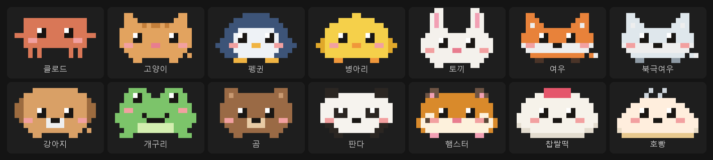

<div align="center">

# cozy-hud

### A tiny companion beside your terminal

A set of Claude Code mods that adds a pixel character and a small dashboard.<br>
It moves while Claude works, jumps when a task is done, and sweats when context runs low.

[](LICENSE)
[](#get-started)

[](#your-data-stays-on-your-machine)

[한국어](README.md) · **English** · [日本語](README.ja.md) · [简体中文](README.zh-CN.md)



</div>

---

> The in-app text (settings, speech bubbles, cards) is Korean for now.

## Waiting, made a little less dull

Once Claude is working, the screen is just text piling up. It is hard to tell at a glance what it is doing, how much it has used, or how much context is left.

**cozy-hud** puts a small character and a dashboard in a side pane and in one line above the prompt.

- The character taps its feet while Claude works, jumps when a task finishes, sweats when context passes 80%, and falls asleep after a long rest.
- A speech bubble says what Claude is doing with each tool, like "reading register.tsx".
- Install only the cards you want: tokens, context, to-dos. Any mix looks like one design.

## Get started

Install once in Claude Code.

```
/plugin marketplace add HwangSlater/cozy-hud
/plugin install cozy-hud@cozy-hud
```

Add the cards you want.

```
/plugin install cozy-hud-tokens@cozy-hud
/plugin install cozy-hud-context@cozy-hud
/plugin install cozy-hud-checklist@cozy-hud
```

Two tabs open: "HUD" and "HUD settings". That's it.

## What's inside

| Mod | What it does |
| --- | --- |
| `cozy-hud` | Core (required). Side pane, the line above the prompt, settings, 14 characters |
| `cozy-hud-tokens` | Tokens for this reply and the whole session, a bar chart per reply |
| `cozy-hud-context` | Context usage gauge with a warning threshold you choose |
| `cozy-hud-checklist` | Claude's to-do list, live. Can also follow a Markdown checklist file |

Characters: Claude, cat, penguin, chick, rabbit, fox, arctic fox, puppy, frog, bear, panda, hamster, strawberry mochi, steamed bun.

## Change things

Use the mouse or keyboard in the "HUD settings" tab. Changes show up in the preview below right away and stay across sessions.

| Tab | What you pick |
| --- | --- |
| Character | Size in the pane and above the prompt, motion speed, time until sleep |
| Layout · bubbles | Where it shows, tool bubbles, reactions to finishing and warnings |
| Theme | Auto · Basic · Amber · Mint · Mono |
| Cards | Show or hide, order, per-card settings |

Flip characters with `[ < ]` `[ > ]` under the preview, or click the name to pick from the full list.

Keyboard: press `Ctrl+X` then `Tab` to enter the settings tab. `Tab` next item · `Enter` pick · `1`–`4` tabs · `A`/`D` previous/next character · `Esc` leave.

Quick commands:

```
/hud                    open the settings tab
/hud character cat      change character
/hud theme mint         change theme
/hud layout pane        show in the pane only
/hud reset              back to defaults
```

## Your data stays on your machine

cozy-hud makes no network calls. It only draws what Claude Code already knows (token usage, context, tool names, to-dos). Your settings stay in Claude Code's mod storage.

## Make characters and cards

Other mods can depend on the core with `dependencies: ["cozy-hud"]`.

- Characters: pass pixel-letter art and a color table to `$.hud.characters({ list })`. See [core/data/characters.json](core/data/characters.json). One letter is one pixel, `.` is transparent, and `~` is reserved for the sweat drop.
- Cards: send them with `$.hud.put({ id, title, lines, brief })`. Name a role such as `dim`, `ok` or `warn` instead of a color. Types are in [core/types/index.d.ts](core/types/index.d.ts).
- The core sends `hud.ready` when it reloads, so send yours on both `session.start` and `hud.ready`.

## License

[MIT](LICENSE) © [HwangSlater](https://github.com/HwangSlater). The Claude character is fan art of Anthropic's mascot.
