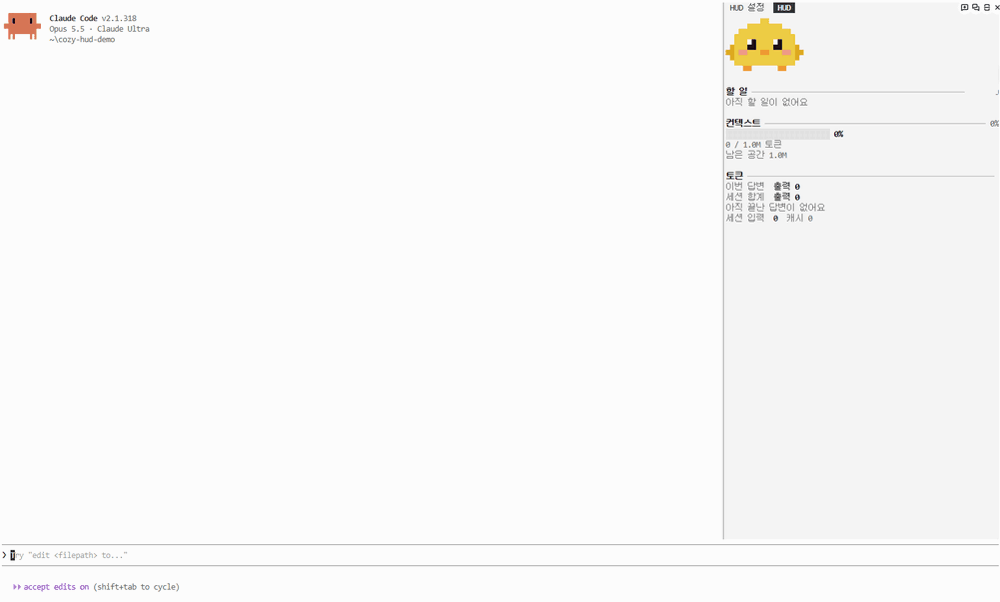
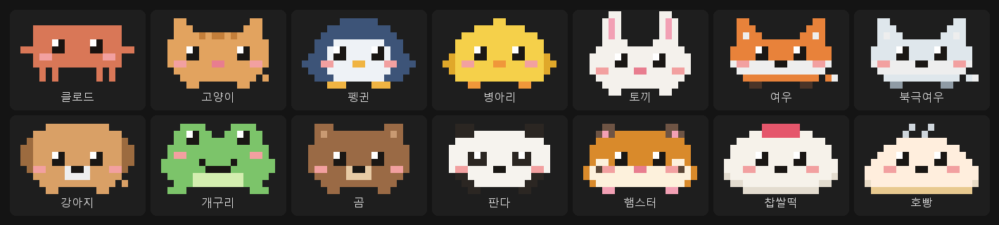
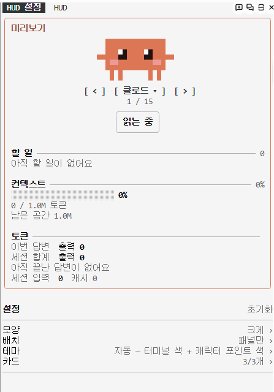
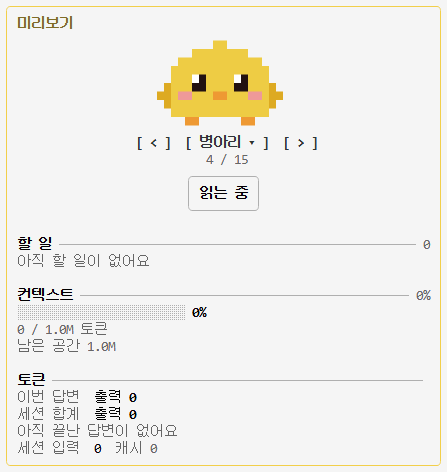
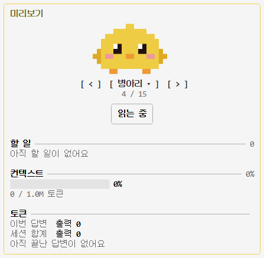
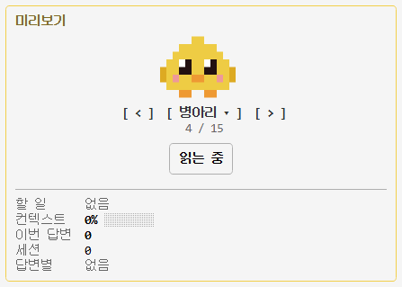

<div align="center">

# cozy-hud

### ターミナルの横に、小さな相棒を

Claude Code にピクセルキャラクターと小さなダッシュボードを付ける mod セット。<br>
Claude が作業すると一緒に動き、終わると跳ね、コンテキストが減ると汗をかきます。

[](LICENSE)
[](#はじめかた)

[](#データは自分のパソコンだけに)

[한국어](README.md) · [English](README.en.md) · **日本語** · [简体中文](README.zh-CN.md)



<sub>Claude がバグを直しているところ(3 倍速)。吹き出しが作業内容を伝え、返答が終わるとトークン・コンテキストのカードが埋まります。</sub>

</div>

---

> 画面内の文言(設定・吹き出し・カード)は今のところ韓国語です。

## 待ち時間を、少しだけ楽しく

Claude に作業を任せると、画面には文字が積み重なるだけ。いま何をしているのか、どれだけ使ったのか、コンテキストがどれだけ残っているのか、ひと目では分かりにくいものです。

**cozy-hud** は、横のパネルと入力欄の上の一行に、小さなキャラクターとダッシュボードを置きます。

- Claude の作業中は足を動かし、タスクが終わると跳ね、コンテキストが 80% を超えると汗をかき、しばらく休むと眠ります。
- ツールを使うたびに、何をしているかを吹き出しで知らせます。「register.tsx を読み込み中」のように。
- トークン、コンテキスト、ToDo などのカードは必要なものだけ入れられます。どの組み合わせでも同じデザインで表示されます。

## はじめかた

Claude Code で一度だけインストールします。

```
/plugin marketplace add HwangSlater/cozy-hud
/plugin install cozy-hud@cozy-hud
```

カードは好きなものだけ追加します。

```
/plugin install cozy-hud-tokens@cozy-hud
/plugin install cozy-hud-context@cozy-hud
/plugin install cozy-hud-checklist@cozy-hud
/plugin install cozy-hud-usage@cozy-hud
/plugin install cozy-hud-tools@cozy-hud
/plugin install cozy-hud-git@cozy-hud
/plugin install cozy-hud-agents@cozy-hud
```

「HUD」と「HUD 設定」の 2 つのタブが開きます。これで完了です。

**必要なもの** · mod に対応した Claude Code(2.1.287 以降)· ターミナルとデスクトップアプリで表示(`claude -p`・リモートセッションでは表示されません)· パネル幅 22 桁以上、「大」の形は 50 桁以上 · ネットワークは使いません

## 入っているもの

| mod | 役割 |
| --- | --- |
| `cozy-hud` | コア(必須)。パネルと入力欄の上の一行、設定、キャラクター 14 種 |
| `cozy-hud-tokens` | 今回の返答とセッション全体のトークン量、返答ごとの棒グラフ |
| `cozy-hud-context` | コンテキスト使用率のゲージ。警告の開始 % を選べます |
| `cozy-hud-checklist` | Claude の ToDo リストをリアルタイムで。セッションのチェックリストファイル(`~/.claude/checklists/<セッション>.md`)があれば自動で追い、ほかの Markdown ファイルも指定できます |
| `cozy-hud-usage` | 5 時間・週間の利用上限とリセットまでの時間、返答・セッションの時間と費用 |
| `cozy-hud-tools` | Claude がいま使ったツールを新しい順に(失敗は警告色) |
| `cozy-hud-git` | いまのブランチ、変更ファイル、push していないコミット |
| `cozy-hud-agents` | 動いているサブエージェントごとの名前・作業・経過時間 |

キャラクター:クロード、ネコ、ペンギン、ヒヨコ、ウサギ、キツネ、ホッキョクギツネ、子犬、カエル、クマ、パンダ、ハムスター、いちご大福、肉まん。

<div align="center"></div>

## 変更する

「HUD 設定」タブでマウスかキーボードで変更します。いちばん上のプレビューは常に表示され、その下の一覧から「形 › キャラクター」のように入って選びます。上の経路(「設定 › 形 › キャラクター」)の手前の項目を押すと、その段階にすぐ戻れます。変更はセッションが変わっても残ります。

<div align="center">


<sub>キーボードで操作した画面です。マウスで押しても同じです。</sub>
</div>

| 一覧 | 選べるもの |
| --- | --- |
| 形 | HUD の形(大・中・小)と、その形で使う設定だけ:キャラクターのサイズ、吹き出し、カードごとの設定 |
| 配置 | 表示する場所、入力欄の上のサイズ、動きの速さ、眠るまでの時間、なでるボタン、完了・警告への反応 |
| 通知・記録 | 長くかかった返答が終わったら通知(オフ・30 秒・1 分・3 分以上)、通知音、「今日」の記録カード(返答・変更ファイル・作業時間、初期はオフ) |
| テーマ | 自動・基本・アンバー・ミント・モノクロ |
| カード | 表示・非表示、順番 |

形はパネルの幅に合わせて選びます。**大**(50 桁以上)はカードに詳細行まで、**中**はふだんの形、**小**(22〜32 桁)はカードごとに 1 行にまとめ、行ごとに表示を切り替えられます。

<table align="center">
<tr><th>大</th><th>中</th><th>小</th></tr>
<tr><td valign="top"><br><sub>広いパネル · 詳細行まで</sub></td><td valign="top"><br><sub>ふつうのパネル · カード</sub></td><td valign="top"><br><sub>狭いパネル · カードごとに 1 行</sub></td></tr>
</table>

キャラクターはプレビュー下の `[ < ]` `[ > ]` で切り替えるか、名前を押して一覧から選びます。 キャラクター下の「なでる」を押すと一度よろこびます(配置で隠せます)。

キーボード:`Ctrl+X` のあと `Tab` で設定タブに入り、`Tab` 次の項目・`Enter` 選択・`A`/`D` キャラクター切り替え・`Esc` 抜ける。

すぐ変えるコマンドもあります。

```
/hud                    設定タブを開く
/hud character cat      キャラクターを変える
/hud theme mint         テーマを変える
/hud layout pane        パネルだけに表示
/hud form small         HUD の形を変える(large・medium・small)
/hud reset              初期設定に戻す
```

## データは自分のパソコンだけに

cozy-hud はネットワークを使いません。Claude Code がすでに持っている情報(トークン量、コンテキスト、ツール名、ToDo)を描くだけです。設定は Claude Code の mod ストレージにだけ残ります。

## キャラクター・カードを作る

ほかの mod は `dependencies: ["cozy-hud"]` でコアに頼れます。

- キャラクター:ピクセル文字の絵と色表を `$.hud.characters({ list })` に渡します。形式は [core/data/characters.json](core/data/characters.json) を参照。1 文字が 1 ピクセル、`.` は透明、`~` は汗のしずく用なので色の文字には使いません。
- カード:`$.hud.put({ id, title, lines, brief })` で送ります。色は直接選ばず `dim`・`ok`・`warn` のような役割を書きます。型は [core/types/index.d.ts](core/types/index.d.ts) にあります。
- コアは再読み込み時に `hud.ready` を送るので、`session.start` と `hud.ready` の両方で送ってください。

## ライセンス

[MIT](LICENSE) © [HwangSlater](https://github.com/HwangSlater)。クロードのキャラクターは Anthropic のマスコットのファンアートです。
