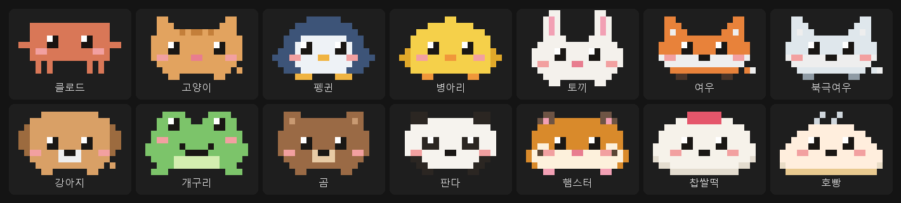
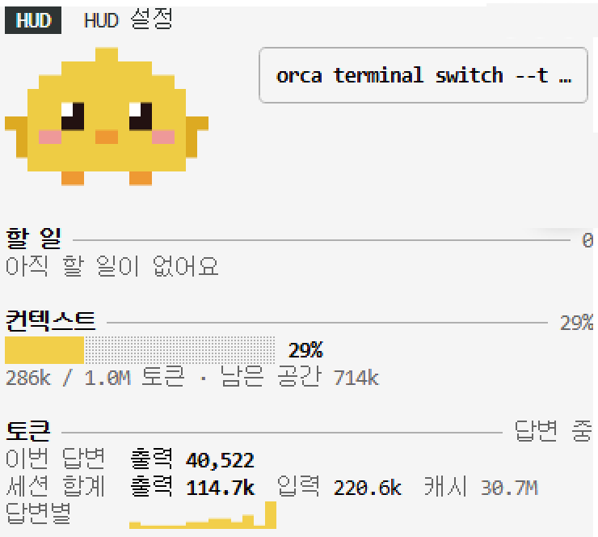
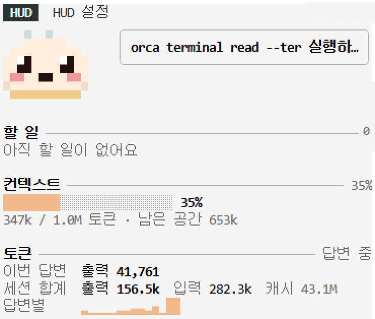

<div align="center">

# cozy-hud

### 터미널 옆에 작은 동료를

Claude Code 옆에 픽셀 캐릭터와 계기판을 붙이는 mod 모음.<br>
Claude가 일하면 같이 움직이고, 끝내면 뛰고, 지치면 땀을 흘려요.

[](LICENSE)
[](#바로-시작하기)

[](#내-데이터는-내-컴퓨터에)

**한국어** · [English](README.en.md) · [日本語](README.ja.md) · [简体中文](README.zh-CN.md)



</div>

---

## 기다리는 시간이 조금 덜 심심하게

Claude에게 일을 맡기고 나면 화면은 글자만 쌓여요. 지금 뭘 하는지, 얼마나 썼는지, 컨텍스트가 얼마나 남았는지 한눈에 보기 어려워요.

**cozy-hud**는 터미널 옆 패널과 입력창 위 한 줄에 작은 캐릭터와 계기판을 붙여요.

- 캐릭터는 Claude가 일하는 동안 발을 움직이고, 할 일을 끝내면 뛰고, 컨텍스트가 80%를 넘으면 땀을 흘리고, 오래 쉬면 잠들어요.
- 도구를 쓸 때마다 말풍선으로 무엇을 하는지 알려 줘요. 「register.tsx 읽는 중」처럼요.
- 토큰, 컨텍스트, 할 일 같은 계기판은 필요한 것만 골라 설치해요. 어떤 조합이든 같은 디자인으로 보여요.

<div align="center">


</div>

## 바로 시작하기

Claude Code에서 한 번만 설치하세요.

```
/plugin marketplace add HwangSlater/cozy-hud
/plugin install cozy-hud@cozy-hud
```

계기판도 원하는 것만 더하세요.

```
/plugin install cozy-hud-tokens@cozy-hud
/plugin install cozy-hud-context@cozy-hud
/plugin install cozy-hud-checklist@cozy-hud
```

설치하면 「HUD」와 「HUD 설정」 두 탭이 열려요. 끝이에요.

## 들어 있는 것

| mod | 하는 일 |
| --- | --- |
| `cozy-hud` | 코어(필수). 패널과 입력창 위 줄, 설정 패널, 캐릭터 14종 |
| `cozy-hud-tokens` | 이번 답변과 세션 전체의 토큰 사용량, 답변별 막대그래프 |
| `cozy-hud-context` | 컨텍스트 사용률 게이지. 경고 시작 %를 고를 수 있어요 |
| `cozy-hud-checklist` | Claude의 할 일 목록을 실시간으로. 마크다운 체크리스트 파일을 지정할 수도 있어요 |

캐릭터는 클로드, 고양이, 펭귄, 병아리, 토끼, 여우, 북극여우, 강아지, 개구리, 곰, 판다, 햄스터, 찹쌀떡, 호빵이에요.

## 바꾸기

「HUD 설정」 탭에서 마우스나 키보드로 바꿔요. 바꾼 값은 아래 미리보기에 바로 보이고, 세션이 바뀌어도 남아요.

| 탭 | 고르는 것 |
| --- | --- |
| 캐릭터 | 패널·입력창 위 크기(크게·보통·작게), 움직임 속도, 잠드는 시간 |
| 배치·말풍선 | 보일 곳(패널·입력창 위), 도구를 쓸 때 말풍선, 끝냄·경고 반응 |
| 테마 | 자동 · 기본 · 호박 · 민트 · 흑백 |
| 카드 | 카드 보임·숨김, 순서, 카드별 설정 |

캐릭터는 미리보기 아래 `[ < ]` `[ > ]`로 넘기거나, 이름을 눌러 전체 목록에서 골라요.

키보드: `Ctrl+X` 다음 `Tab`으로 설정 탭에 들어가면 `Tab` 다음 칸 · `Enter` 고르기 · `1`~`4` 탭 · `A`/`D` 캐릭터 넘기기 · `Esc` 나가기.

바로 바꾸는 명령도 있어요.

```
/hud                    설정 탭 열기
/hud character cat      캐릭터 바꾸기
/hud theme mint         테마 바꾸기
/hud layout pane        패널에만 보이기
/hud reset              처음 설정으로
```

## 내 데이터는 내 컴퓨터에

cozy-hud는 네트워크를 쓰지 않아요. Claude Code가 이미 가진 정보(토큰 사용량, 컨텍스트, 도구 이름, 할 일 목록)를 화면에 그릴 뿐이에요. 고른 설정은 Claude Code의 mod 저장소에만 남아요.

## 캐릭터·계기판 만들기

다른 mod가 `dependencies: ["cozy-hud"]`로 코어에 기대어 캐릭터나 카드를 더할 수 있어요.

- 캐릭터: `$.hud.characters({ list })`로 픽셀 글자 그림과 색표를 넘겨요. 형식은 [core/data/characters.json](core/data/characters.json)을 보세요. 글자 하나가 픽셀 하나이고 `.`은 투명, `~`은 땀방울 자리라 색 글자로 쓰지 않아요.
- 카드: `$.hud.put({ id, title, lines, brief })`로 보내요. 색은 직접 고르지 않고 `dim`·`ok`·`warn` 같은 역할만 적어요. 형식은 [core/types/index.d.ts](core/types/index.d.ts)에 있어요.
- 코어가 다시 불러와지면 `hud.ready`를 보내니, `session.start`와 `hud.ready` 둘 다에서 보내면 돼요.

## 라이선스

[MIT](LICENSE) © [HwangSlater](https://github.com/HwangSlater). 클로드 캐릭터는 Anthropic의 마스코트를 본뜬 팬아트예요.
