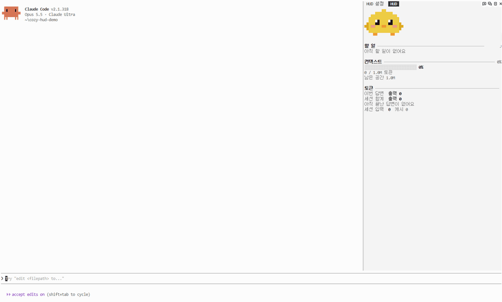
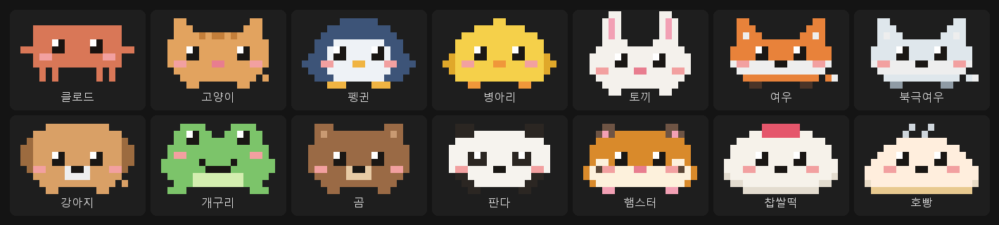
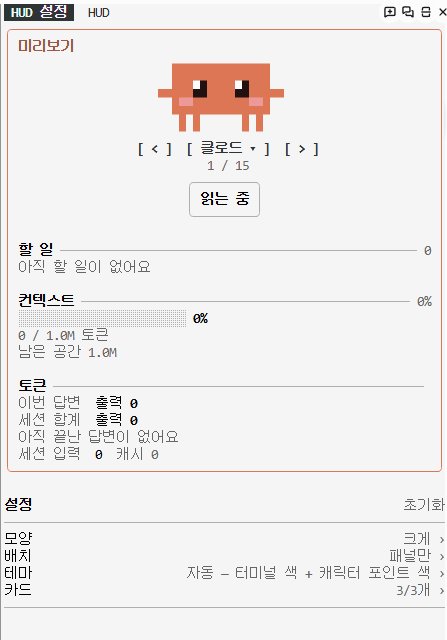
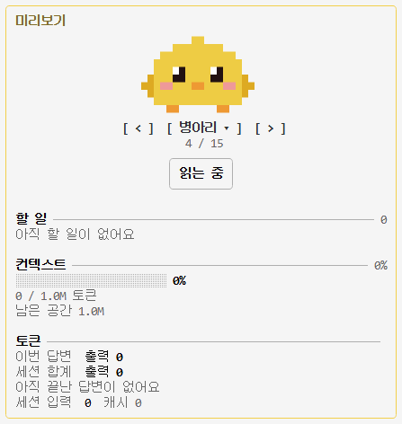
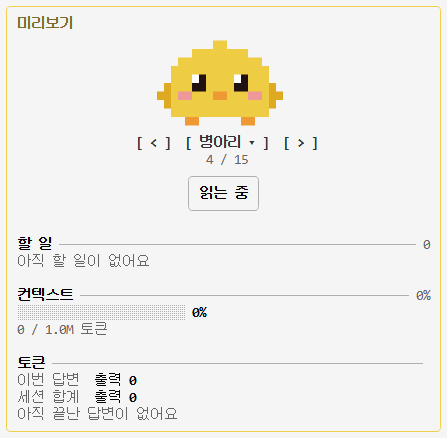
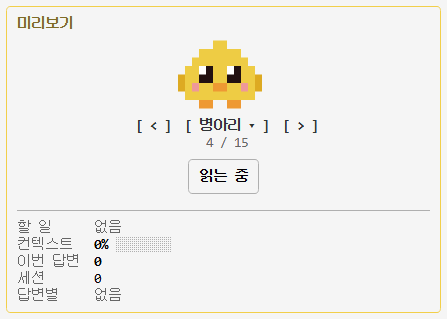

<div align="center">

# cozy-hud

### 终端旁的小伙伴

为 Claude Code 加上像素角色和小仪表盘的 mod 合集。<br>
Claude 工作时它跟着动，完成任务时会跳起来，上下文快满时会冒汗。

[](LICENSE)
[](#快速开始)

[](#数据只留在你的电脑上)

[한국어](README.md) · [English](README.en.md) · [日本語](README.ja.md) · **简体中文**



<sub>Claude 正在修 bug(3 倍速)。气泡显示正在做什么，回复结束后令牌和上下文卡片会填上。</sub>

</div>

---

> 界面里的文字(设置、气泡、卡片)目前是韩语。

## 让等待不那么无聊

把工作交给 Claude 之后，屏幕上只有不断堆叠的文字。它正在做什么、用了多少、上下文还剩多少，很难一眼看清。

**cozy-hud** 在侧边面板和输入框上方的一行里，放上一个小角色和仪表盘。

- Claude 工作时角色会踏步，任务完成时会跳，上下文超过 80% 时会冒汗，长时间休息会睡着。
- 每次使用工具时，用气泡告诉你它在做什么，比如"正在读取 register.tsx"。
- 令牌、上下文、待办等卡片只装需要的。任何组合都是同一套设计。

## 快速开始

在 Claude Code 里安装一次即可。

```
/plugin marketplace add HwangSlater/cozy-hud
/plugin install cozy-hud@cozy-hud
```

按需添加卡片。

```
/plugin install cozy-hud-tokens@cozy-hud
/plugin install cozy-hud-context@cozy-hud
/plugin install cozy-hud-checklist@cozy-hud
/plugin install cozy-hud-usage@cozy-hud
/plugin install cozy-hud-tools@cozy-hud
/plugin install cozy-hud-git@cozy-hud
/plugin install cozy-hud-agents@cozy-hud
```

会打开 "HUD" 和 "HUD 设置" 两个标签页。就这样。

**环境要求** · 支持 mod 的 Claude Code(2.1.287 及以上)· 在终端和桌面应用中显示(`claude -p` 和远程会话中不显示)· 面板宽度至少 22 列，"大" 样式建议 50 列以上 · 不使用网络

## 包含内容

| mod | 作用 |
| --- | --- |
| `cozy-hud` | 核心(必需)。侧边面板、输入框上方一行、设置、14 个角色 |
| `cozy-hud-tokens` | 本次回复和整个会话的令牌用量，每次回复的柱状图 |
| `cozy-hud-context` | 上下文用量仪表，可以选择警告起点 % |
| `cozy-hud-checklist` | 实时显示 Claude 的待办列表。有会话清单文件(`~/.claude/checklists/<会话>.md`)时自动跟随，也可以指定其他 Markdown 文件 |
| `cozy-hud-usage` | 5 小时和每周用量上限及距重置的时间，本次回复和会话的时长与费用 |
| `cozy-hud-tools` | Claude 刚用过的工具，按时间倒序(失败的用警告色) |
| `cozy-hud-git` | 当前分支、改动的文件、未推送的提交 |
| `cozy-hud-agents` | 每个正在运行的子代理的名称、正在做的事和已用时间 |

角色:Claude、猫、企鹅、小鸡、兔子、狐狸、北极狐、小狗、青蛙、熊、熊猫、仓鼠、草莓大福、包子。

<div align="center"></div>

## 修改设置

在 "HUD 设置" 标签页里用鼠标或键盘修改。最上方的预览始终可见，在下面的列表中像 "样式 › 角色" 这样进入后选择。点击顶部路径("设置 › 样式 › 角色")前面的部分，可直接回到那一层。改动换会话也会保留。

<div align="center">


<sub>这里用键盘操作，用鼠标点击也一样。</sub>
</div>

| 列表 | 可选内容 |
| --- | --- |
| 样式 | HUD 样式(大·中·小)以及该样式用到的设置:角色大小、气泡、每张卡片的设置 |
| 布局 | 显示位置、输入框上方的大小、动作速度、入睡时间、抚摸按钮、完成和警告时的反应 |
| 通知·记录 | 耗时较长的回复结束时提醒(关闭·超过 30 秒·1 分钟·3 分钟)、提示音、"今天" 记录卡片(回复·改动文件·工作时长，默认关闭) |
| 主题 | 自动 · 基本 · 琥珀 · 薄荷 · 黑白 |
| 卡片 | 显示或隐藏、顺序 |

按面板宽度选择样式。**大**(50 列以上)在卡片里加上详细行，**中**是常规样式，**小**(22–32 列)把每张卡片缩成一行，每一行都可以单独开关。

<table align="center">
<tr><th>大</th><th>中</th><th>小</th></tr>
<tr><td valign="top"><br><sub>宽面板 · 含详细行</sub></td><td valign="top"><br><sub>普通面板 · 卡片</sub></td><td valign="top"><br><sub>窄面板 · 每张卡片一行</sub></td></tr>
</table>

在预览下方用 `[ < ]` `[ > ]` 切换角色，或点名字从完整列表中选择。 点角色下方的 "抚摸"，角色会开心地跳一下(可在布局里隐藏)。

键盘:按 `Ctrl+X` 再按 `Tab` 进入设置标签页。`Tab` 下一项 · `Enter` 选择 · `A`/`D` 切换角色 · `Esc` 离开。

也有直接修改的命令:

```
/hud                    打开设置标签页
/hud character cat      更换角色
/hud theme mint         更换主题
/hud layout pane        只在面板显示
/hud form small         更换 HUD 样式(large·medium·small)
/hud reset              恢复默认
```

## 数据只留在你的电脑上

cozy-hud 不使用网络。它只是把 Claude Code 已有的信息(令牌用量、上下文、工具名、待办)画出来。设置只保存在 Claude Code 的 mod 存储里。

## 制作角色和卡片

其他 mod 可以用 `dependencies: ["cozy-hud"]` 依赖核心。

- 角色:把像素字符画和颜色表传给 `$.hud.characters({ list })`。格式见 [core/data/characters.json](core/data/characters.json)。一个字符是一个像素，`.` 是透明，`~` 留给汗珠，不要用作颜色字符。
- 卡片:用 `$.hud.put({ id, title, lines, brief })` 发送。不要直接选颜色，写 `dim`、`ok`、`warn` 这样的角色。类型在 [core/types/index.d.ts](core/types/index.d.ts)。
- 核心重新加载时会发送 `hud.ready`，所以请在 `session.start` 和 `hud.ready` 两处都发送。

## 许可证

[MIT](LICENSE) © [HwangSlater](https://github.com/HwangSlater)。Claude 角色是 Anthropic 吉祥物的同人作品。
