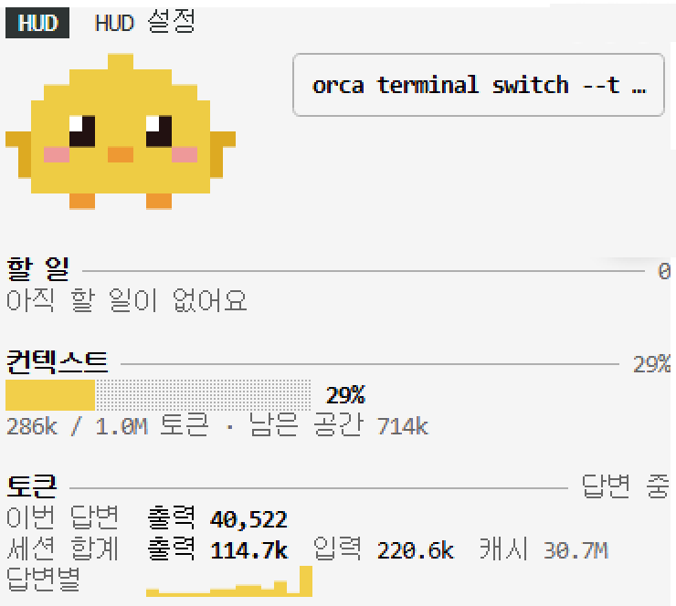
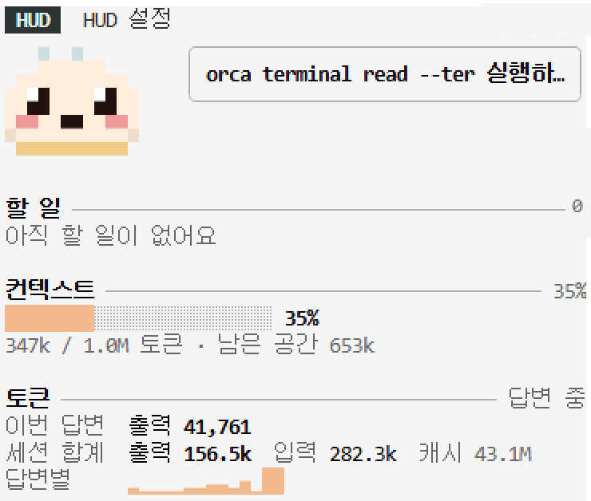

<div align="center">

# cozy-hud

### 终端旁的小伙伴

为 Claude Code 加上像素角色和小仪表盘的 mod 合集。<br>
Claude 工作时它跟着动，完成任务时会跳起来，上下文快满时会冒汗。

[](LICENSE)
[](#快速开始)

[](#数据只留在你的电脑上)

[한국어](README.md) · [English](README.en.md) · [日本語](README.ja.md) · **简体中文**


</div>

---

> 界面里的文字(设置、气泡、卡片)目前是韩语。

## 让等待不那么无聊

把工作交给 Claude 之后，屏幕上只有不断堆叠的文字。它正在做什么、用了多少、上下文还剩多少，很难一眼看清。

**cozy-hud** 在侧边面板和输入框上方的一行里，放上一个小角色和仪表盘。

- Claude 工作时角色会踏步，任务完成时会跳，上下文超过 80% 时会冒汗，长时间休息会睡着。
- 每次使用工具时，用气泡告诉你它在做什么，比如"正在读取 register.tsx"。
- 令牌、上下文、待办等卡片只装需要的。任何组合都是同一套设计。

<div align="center">


</div>

## 快速开始

在 Claude Code 里安装一次即可。

```
/plugin marketplace add HwangSlater/cozy-hud
/plugin install cozy-hud@cozy-hud
```

按需添加卡片。

```
/plugin install cozy-hud-tokens@cozy-hud
/plugin install cozy-hud-context@cozy-hud
/plugin install cozy-hud-checklist@cozy-hud
```

会打开 "HUD" 和 "HUD 设置" 两个标签页。就这样。

## 包含内容

| mod | 作用 |
| --- | --- |
| `cozy-hud` | 核心(必需)。侧边面板、输入框上方一行、设置、14 个角色 |
| `cozy-hud-tokens` | 本次回复和整个会话的令牌用量，每次回复的柱状图 |
| `cozy-hud-context` | 上下文用量仪表，可以选择警告起点 % |
| `cozy-hud-checklist` | 实时显示 Claude 的待办列表，也可以指定 Markdown 清单文件 |

角色:Claude、猫、企鹅、小鸡、兔子、狐狸、北极狐、小狗、青蛙、熊、熊猫、仓鼠、草莓大福、包子。

## 修改设置

在 "HUD 设置" 标签页里用鼠标或键盘修改。改动会立刻显示在下方预览中，换会话也会保留。

| 标签 | 可选内容 |
| --- | --- |
| 角色 | 面板和输入框上方的大小(大·中·小)、动作速度、入睡时间 |
| 布局·气泡 | 显示位置、使用工具时的气泡、完成和警告时的反应 |
| 主题 | 自动 · 基本 · 琥珀 · 薄荷 · 黑白 |
| 卡片 | 显示或隐藏、顺序、每张卡片的设置 |

在预览下方用 `[ < ]` `[ > ]` 切换角色，或点名字从完整列表中选择。

键盘:按 `Ctrl+X` 再按 `Tab` 进入设置标签页。`Tab` 下一项 · `Enter` 选择 · `1`–`4` 标签 · `A`/`D` 切换角色 · `Esc` 离开。

也有直接修改的命令:

```
/hud                    打开设置标签页
/hud character cat      更换角色
/hud theme mint         更换主题
/hud layout pane        只在面板显示
/hud reset              恢复默认
```

## 数据只留在你的电脑上

cozy-hud 不使用网络。它只是把 Claude Code 已有的信息(令牌用量、上下文、工具名、待办)画出来。设置只保存在 Claude Code 的 mod 存储里。

## 制作角色和卡片

其他 mod 可以用 `dependencies: ["cozy-hud"]` 依赖核心。

- 角色:把像素字符画和颜色表传给 `$.hud.characters({ list })`。格式见 [core/data/characters.json](core/data/characters.json)。一个字符是一个像素，`.` 是透明，`~` 留给汗珠，不要用作颜色字符。
- 卡片:用 `$.hud.put({ id, title, lines, brief })` 发送。不要直接选颜色，写 `dim`、`ok`、`warn` 这样的角色。类型在 [core/types/index.d.ts](core/types/index.d.ts)。
- 核心重新加载时会发送 `hud.ready`，所以请在 `session.start` 和 `hud.ready` 两处都发送。

## 许可证

[MIT](LICENSE) © [HwangSlater](https://github.com/HwangSlater)。Claude 角色是 Anthropic 吉祥物的同人作品。
